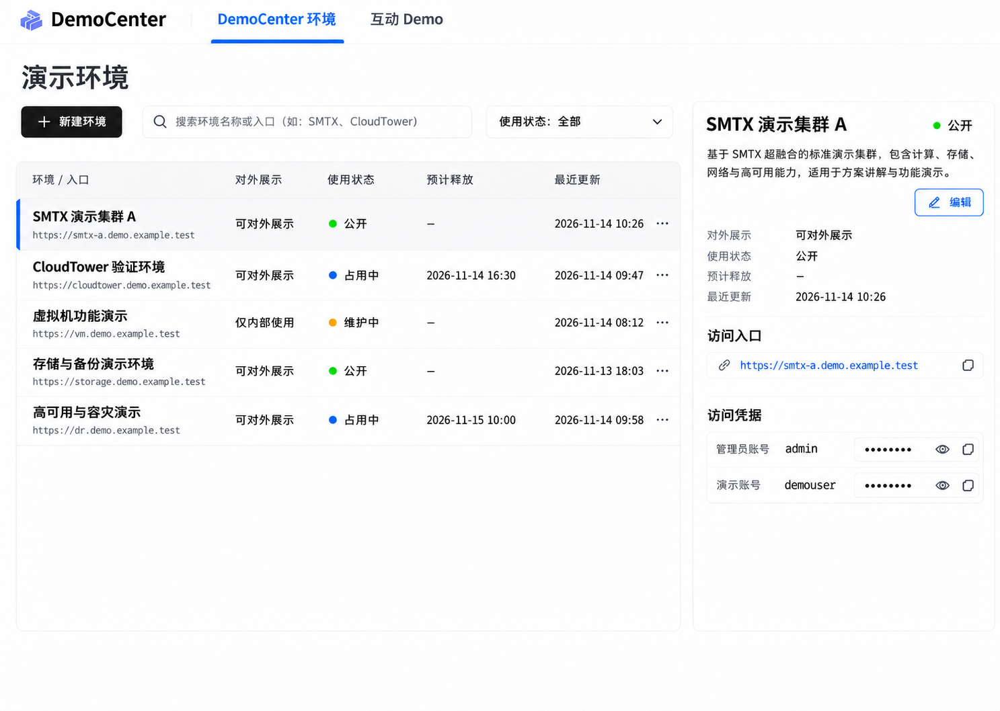
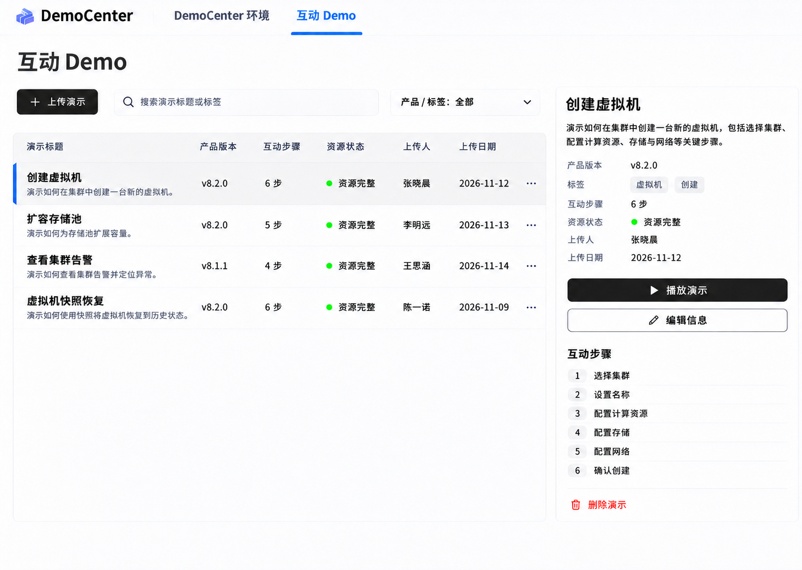
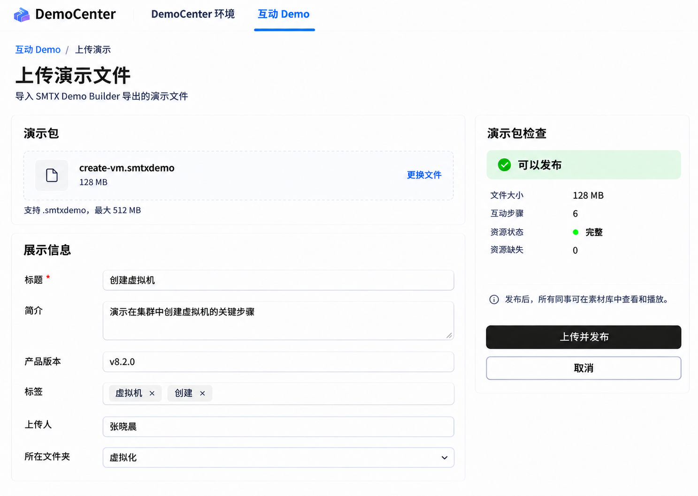
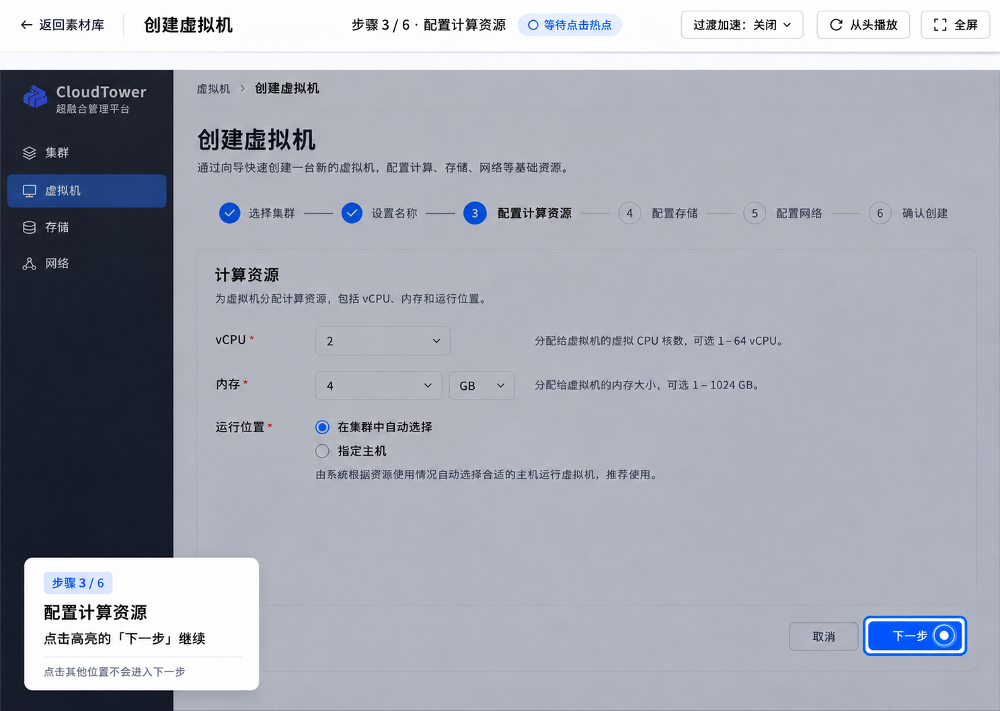

# DemoCenter 第一版设计

日期：2026-11-14

## 目标与已确认范围

DemoCenter 是部署在公司内网、供同事使用的工作网站。第一版解决两件事：集中展示和维护内部演示环境的信息；集中上传、查找和播放 SMTX Demo Builder 制作的互动演示。演示播放器必须保留“到达步骤时暂停，点击指定热点才继续”的体验，而不是普通视频播放。

所有同事可以查看并修改演示环境的状态、入口、账号和密码，也可以上传与播放演示。第一版不设置审批、逐项授权、角色分工或操作审计。演示上传人使用手填名称，不依赖网站账户。网站由 Docker Compose 部署在一台内网服务器上。

第一版只播放现有网页录制产生的 rrweb 演示。VNC 新标签页画面录制与播放、PPT 加载项、视频导出、网站内录制与热点编辑都不在本版范围内。播放器不访问原平台执行真实操作。

## 方案选择

| 方案 | 组成 | 取舍 |
| --- | --- | --- |
| 轻量版 | 单体网站、SQLite、演示文件目录 | 部署简单，但以后扩展数据库和并发处理时可能迁移。 |
| **标准版（已选）** | 网站应用、PostgreSQL、演示文件目录，由 Docker Compose 管理 | 增加一个数据库服务，适合持续由多人维护环境和上传演示。 |
| 大型版（暂不采用） | 标准版加对象存储、任务队列等 | 适合多节点和大量视频素材，但对第一版过重。 |

第一版采用标准版，不预置 MinIO、消息队列或 Kubernetes。网站应用负责前端页面、API 与演示包导入；PostgreSQL 保存环境和演示元数据；演示事件、步骤与静态资源保存在持久化文件目录。应用与数据库作为 Compose 服务启动，持久化目录独立于容器可写层。

## 网站结构与使用流程

网站顶层提供“DemoCenter 环境”和“互动 Demo”两个入口。页面以桌面浏览器为主要使用场景，兼容 Windows 上的 Edge 与 Chrome。

第一版采用浅色工作台：白色页面、近黑正文、浅灰分隔、黑色主按钮，蓝色仅用于链接、选中态与焦点。字体采用 Geist Sans 显示英文和数字，思源黑体 CN 显示中文，网址与编号使用 Geist Mono；字体文件随网站提供，微软雅黑作为中文回退。桌面页面以清晰的表格和详情侧栏组织信息，避免装饰性图表和大面积彩色卡片。环境页主标题与操作栏之间保持约 32px 的间距。当前页面预览稿见下图；文字内容与字段定义以本文为准。

### 演示环境

列表展示环境名称、产品/用途、入口地址、CPU 架构、对外展示状态、使用状态、预计释放时间和最后更新时间；不展示或记录占用人。CPU 架构单选 X86、Hygon、Kunpeng，既有环境未设置时显示“未指定”。支持按状态筛选及关键字搜索。点击环境进入详情，可查看账号密码、备注和完整入口，并直接修改全部字段。账号可以是一条或多条带用途标签的记录；密码在详情中默认遮盖，可点击显示或复制，所有同事均可操作，无额外审批。

“对外展示状态”和“使用状态”是两个独立字段：

- 对外展示状态：可对外展示 / 仅内部使用。
- 使用状态：公开 / 可申请 / 维护中 / 占用中。这里的“公开”表示当前可供同事使用；“可申请”表示需联系负责人后使用，第一版仅展示状态，不提供在线申请流程。是否可对外展示仍由独立字段决定。
- 占用中可填写预计释放时间和说明，不填写占用人；退出该状态时清空预计释放时间。

所有同事可新建、编辑和删除环境。保存后列表立即更新；不同人同时修改同一字段时，最后成功提交的值生效。页面显示最后更新时间，但不记录修改历史。删除环境须二次确认。

### 互动 Demo 素材库

素材库列表显示标题、简介、产品版本、场景标签、上传人、上传时间、互动步骤数量与资源完整度提示；支持搜索标题和标签。所有同事可上传、编辑展示信息、播放和删除演示。上传通过基本格式校验后立即可见，无审核流程；删除须二次确认。首次使用时素材库为空，显示上传入口，不预置任何演示。下图的条目仅用于展示列表排版。

素材库左侧提供一级文件夹列表，包括“全部演示”和“未分类”两个固定入口。所有同事可新建、重命名和删除自建文件夹；文件夹不能嵌套，名称在素材库内唯一。上传时可选择文件夹：从某文件夹发起上传时默认选中该文件夹，从“全部演示”发起时默认归入“未分类”。已上传演示可通过“移动到”选择其他文件夹或“未分类”。选择文件夹后只显示其中的演示；“全部演示”跨文件夹搜索。删除文件夹前二次确认，删除后其中的演示移至“未分类”，演示文件本身不删除。

上传内容是一个由 SMTX Demo Builder 导出的单演示包，而非任意网页 URL 或视频。上传采用独立页面，页面标题为“上传演示文件”，说明为“导入 SMTX Demo Builder 导出的演示文件”：选择 `.smtxdemo` 文件后显示文件大小、互动步骤和资源完整度等检查结果，再填写展示信息并发布。标题默认取录制清单中的名称且为唯一必填的展示字段；简介、产品版本、标签和上传人可补充。文件夹默认取发起上传的位置，或“未分类”。每次上传生成一条新的站点记录；重复上传同一源演示不会覆盖既有记录。第一版不做版本历史或覆盖更新，旧演示可手动删除。

“播放”打开独立、可全屏的网页播放器。播放器自动播放至下一交互步骤并暂停，显示热点及步骤名称；点击热点继续，点击其他区域只提示正确位置。顶部只提供返回素材库、从头播放、全屏和过渡加速，不提供绕过热点的“下一步”按钮。过渡加速沿用现有工具的关闭、1 秒、2 秒、3 秒选项，默认关闭。回放画面不显示模拟鼠标指针，点击圆圈保留。至少包含一个热点的演示才能发布；无热点、录制未完成或无有效事件的包在上传时给出明确错误，要求先回到录制器完善。下图中的管理平台画面仅用于说明播放器布局，实际画面来自上传的录制包。

## 录制器与网站的衔接

现有扩展把 `manifest.json`、`steps.json`、`events/*.json` 和 `assets/*` 写入售前选择的本机目录；播放器从扩展的目录句柄读取，不能直接搬到网站。第一版需要两处有边界的改造：

1. 扩展增加“导出演示包”，将一条已完成演示的现有文件及包格式版本清单打成一个 ZIP 文件，建议扩展名为 `.smtxdemo`；导出不删除或修改本机素材。
2. 网站导入该包，校验清单、事件、热点和资源引用后存储；网页播放器通过网站 API 读取相同的演示模型。将现有播放器的热点控制与 rrweb 回放逻辑抽成可复用模块，并把本地目录读取替换为网站数据源。

网站保留原始录制的 `formatVersion`（当前为 1 或 2），另有独立的演示包格式版本，便于未来演进。上传时只接受受支持版本和约定目录结构；限制解包后路径、文件数量和总大小。上传大小上限作为部署配置，第一版默认 512 MB，超限时在上传前和服务端均明确提示。导入在临时目录完成，校验通过后再使演示出现在列表；失败不留下半条可播放记录。

播放器优先使用包内已保存的资源。旧版或部分离线资源缺失的演示，在素材库和播放器中显示“资源不完整”提示；是否能显示全部画面仍需实际播放验证，不承诺所有网页都可完全离线回放。网站不尝试抓取原平台的新资源，也不执行录制快照里的平台脚本。

## 数据与接口边界

PostgreSQL 的核心记录是：

- `environments`：名称、用途、入口、两个状态、预计释放时间、备注、账号数组与更新时间；无占用人字段。
- `demo_folders`：文件夹 ID、名称和创建时间；仅一级，无父文件夹字段。
- `demos`：站点 ID、文件夹 ID（可为空，表示“未分类”）、展示信息、上传人、时间、源演示 ID、录制格式版本、包格式版本、热点数量、资源状态和文件目录。

演示大文件不进入数据库。网站应用通过 `/api/environments` 提供列表、新建、修改和删除，通过 `/api/demo-folders` 提供文件夹列表、新建、重命名和删除，通过 `/api/demos` 提供列表、上传、展示信息及所属文件夹修改与删除，通过 `/api/demos/:id/playback` 和受控的资源地址供播放器加载。上传及删除的数据库记录与演示文件目录要保持一致；文件写入失败时不发布，删除失败时向用户报告而不显示成功。

第一版不提供应用内登录、角色或审计。演示上传人是展示字段，不构成身份验证。站点按“仅在公司内网可达”这一部署前提设计；若未来需要对外访问或真实用户身份，再单独增加访问控制方案。

## 部署与维护

Compose 至少包含 `app` 与 `postgres` 两个服务，以及数据库和演示文件各自的持久化卷。应用对内提供健康检查；内网访问入口可接入现有反向代理和 HTTPS 终止，也可由同一 Compose 项目提供代理服务。镜像中包含构建后的前端与 API，不把应用源码以可写卷挂载到运行容器。

部署说明包含首次启动、升级、备份与恢复。备份必须同时覆盖数据库与演示文件目录；重建容器后，环境清单和已上传演示应保持可用。第一版可单机运行，不承诺跨节点部署。

## 第一版验收标准

1. 同事可在网站新建演示环境，查看并修改入口、多个账号及密码、对外展示状态、使用状态及预计释放时间；页面没有占用人字段，刷新后内容保持一致。
2. 两位同事先后修改同一环境，列表展示最后成功保存的值，并显示新的更新时间；不出现无法解释的部分保存状态。
3. 售前从扩展导出一条已完成、含热点的演示，另一位同事上传到网站后，无需安装录制扩展即可打开并播放。
4. 播放到热点时暂停，错误点击不能推进，正确点击推进；从头播放、全屏、播放加速可用；播放不向原管理平台提交操作。
5. 缺失资源可带明确警告发布；无热点、录制未完成、包损坏和上传超限均有可理解的错误提示，且不发布这些不可播放的半成品。
6. 重启或更新 Compose 容器后，环境数据、账号密码和演示素材仍可读取；完成一次数据库与演示文件的备份恢复演练。
7. 同事可创建一级文件夹、上传到指定文件夹、移动已有演示并重命名文件夹；删除非空文件夹后，原有演示仍可在“未分类”中找到和播放。

## 留给实现阶段决定的细节

前端组件库、Node API 框架、PostgreSQL 迁移工具、压缩库及实际容器镜像选择由实现阶段决定，但应沿用现有 TypeScript/React 代码与 rrweb 版本，避免为第一版引入不必要的技术栈。页面样式应延续 SMTX Demo Builder 的专业工具语气；具体视觉稿不属于本设计文档的验收条件。
